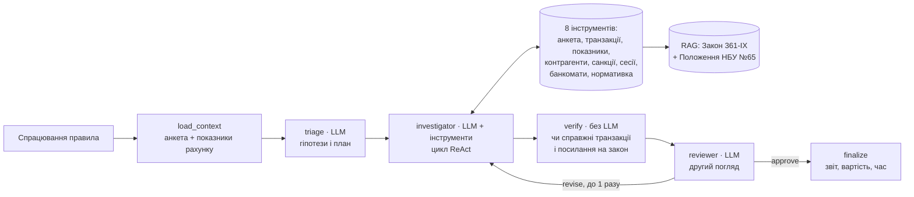

# Архітектура FinMon Copilot

## Граф агентів (LangGraph)

| Вузол | Що робить | Чому так |
|---|---|---|
| `load_context` | Анкета клієнта і 20+ агрегованих показників рахунку без LLM | Модель отримує стислий огляд замість сотень транзакцій: дешевше і менше шуму |
| `triage` | 2–4 гіпотези (схеми і легальні пояснення) та план перевірки | Планування перед дією: розслідувач не блукає |
| `investigator` | Цикл «подумав → викликав інструмент → подивився результат» до 8 кроків | Агент сам вирішує, які дані потрібні; strict tool use гарантує валідні аргументи |
| `verify` | Детермінована перевірка: кожна транзакція існує і належить клієнту, кожне посилання на нормативку агент справді отримав із пошуку | Захист від галюцинацій без ще одного виклику LLM |
| `reviewer` | Приймає висновок або повертає на доопрацювання зі списком прогалин | Два агенти з різними ролями помічають більше, ніж один |
| `finalize` | Збирає звіт; посилання, яких не було в пошуку, відкидаються | У звіт для людини потрапляють лише перевірені джерела |

Стан графа — `TypedDict` з редюсерами `operator.add` для журналів викликів і інструментів, тож кожен прогін повністю відтворюваний через `traces/*.jsonl`.

## Пошук по нормативці (RAG)

1. **Джерела**: Закон України №361-IX (редакція від 23.10.2026) і Положення НБУ №65 разом з Додатком 19 «Критерії ризику» і Додатком 20 «Індикатори підозрілості».
2. **Нарізка** (`finmon/rag/chunking.py`): за структурою документа — стаття → частина → пункт, а для Положення — додаток → розділ → пункт. Кожен фрагмент має посилання на свою структурну одиницю (`law:art20:ch1`, `nbu:annex20:III:p68`), а також короткий заголовок-контекст.
3. **Індекс** (`finmon/rag/index.py`): вектори (fastembed, багатомовна модель) у Qdrant + BM25 для точних слів і номерів; результати зливаються через Reciprocal Rank Fusion.
4. **Оцінка** (`evals/run_retrieval_eval.py`): 30 запитань аналітика з відомою правильною статтею чи пунктом; метрики Recall@5 і MRR@10 для кожної комбінації нарізки, моделі ембедингів і режиму пошуку.

## Моделі, провайдери і вартість

Основні моделі — Claude (Haiku, Sonnet, Opus). Усі виклики йдуть через `finmon/llm.py` — спільний LLM-інтерфейс, тому граф агентів не знає, яка модель відповідає, і провайдера можна замінити без зміни агентів:
- **Anthropic** (офіційний SDK): структуровані відповіді через `messages.parse` з Pydantic-схемами, strict tool use, автоматичне кешування промпта (`cache_control`), серверний fallback на випадок відмови моделі для Opus і Sonnet;
- **резервний провайдер** (зараз Google Gemini через `google-genai`): адаптер перекладає історію діалогу з формату Anthropic у формат провайдера і повертає відповідь тими самими блоками `tool_use` / `text`. Висновок разом з інструментами резервна модель здає викликом службової функції `submit_result` зі схемою відповіді (режим `ANY`);
- облік токенів і вартості кожного виклику за прайсом провайдера.

Конфігурації (`finmon/config.py`): усі ролі на Opus 5.5, Sonnet 5.5, Haiku 5.5, Gemini 3.8 Flash, Gemini 3.5 Flash Lite, і `routed` — Haiku збирає факти, Sonnet перевіряє висновок.

## Надійність

- **Повтори:** обидва SDK повторюють запит при мережевих збоях, 429 і 5xx з експоненційною затримкою.
- **Резервний провайдер:** якщо модель недоступна і після повторів, `LLM.call` переключає саме цей виклик на модель іншого провайдера (`PROVIDER_FALLBACK`: Claude → Gemini 3.8 Flash, Gemini → Claude Haiku). Розслідування продовжується з того самого місця: історія з викликами інструментів однієї моделі перекладається для іншої. Перевірено живими прогонами: збій Anthropic посеред циклу інструментів і збій Gemini посеред циклу — обидва розбори дійшли до правильного рішення без порушень посилань.
- **Імітація збою:** `FINMON_CHAOS=anthropic` вимикає провайдера, щоб перевірити резерв без справжньої аварії.
- **Відповіді API:** обидва провайдери недоступні → 503, модель відмовилась → 422, замість падіння сервера.

## MCP-сервер

`finmon/mcp_server.py` відкриває інструменти розслідування через Model Context Protocol, тому аналітик може працювати прямо в Claude Desktop або Claude Code: Claude сам викликає ті самі 8 інструментів, що й агент-розслідувач, або запускає весь граф одним інструментом `investigate_alert`.

- 11 інструментів: `list_alerts`, `get_alert`, 8 інструментів даних і пошуку по нормативці, `investigate_alert`. Інструменти даних — лише на читання.
- Той самий диспетчер `ToolBox`, що й у графі: однакова поведінка і метрики в обох режимах.
- `.mcp.json` у корені — Claude Code пропонує підключити сервер, коли відкриваєш репозиторій. Вручну: `claude mcp add finmon -- python -m finmon.mcp_server`.
- `tests/test_mcp.py` піднімає сервер справжнім stdio-клієнтом MCP, перевіряє список інструментів і отримання даних.

## Моніторинг

- `finmon/obs.py`: метрики Prometheus — розбори за рішеннями, помилки, час і вартість розбору (гістограми), виклики моделей, токени і витрати за моделями, виклики інструментів, переключення на резерв, порушення обґрунтованості посилань.
- `/metrics` — для Prometheus, `/monitor` — сторінка для людини: частка помилок, p50 і p95 часу, вартість, рішення, останні розбори і переключення.
- Структуровані JSON-логи: подія на кожен розбір, переключення провайдера і помилку, з `alert_id`.
- `deploy/prometheus/alerts.yml` — 6 правил алертів: сервіс не відповідає, понад 5% помилок, p95 довше 2 хвилин, вартість розбору вища за $0.10, переключення на резерв, агент послався на дані, яких не отримував. Правила покриті модульними тестами `promtool test rules`.

## Перевірка якості (CI)

`.github/workflows/ci.yml` на кожен push: тести без API, оцінка пошуку по нормативці з порогом Recall@5 ≥ 80%, тести правил алертів. Прогін агентів на 40 спрацюваннях витрачає гроші, тому запускається вручну і перевіряє пороги з `evals/thresholds.json`: точність ≥ 90%, 0 пропущених схем, не більше 1 хибної ескалації, обґрунтованість посилань ≥ 98%, вартість ≤ $0.06 за розбір.

## Що змінив би для продакшену

Повний план розвитку з пріоритетами — у [ROADMAP.md](ROADMAP.md). Коротко:

- Qdrant у режимі сервера замість локального файлового режиму; трасування агентів через LangSmith або Langfuse на додачу до метрик.
- Справжні дані банку через read-only API, маскування персональних даних перед відправкою в модель.
- Людина в контурі: агент готує висновок, рішення про повідомлення до Держфінмоніторингу ухвалює відповідальний працівник.
- Оцінювальний набір з реальних розібраних кейсів замість синтетичних.
